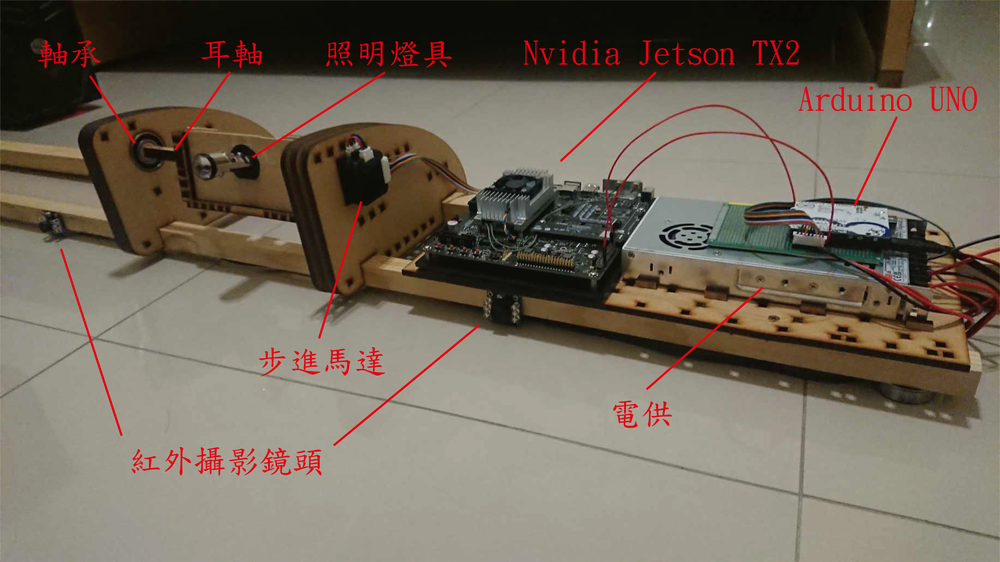
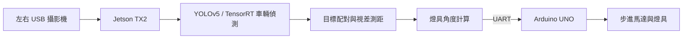
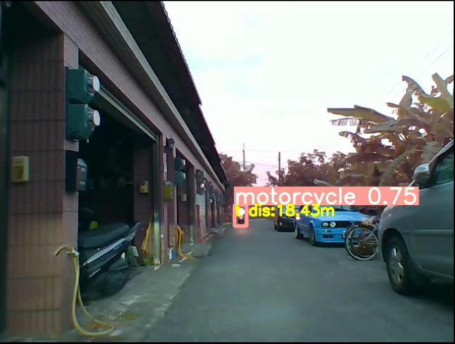

# 基於影像辨識之自適應車輛照明系統

以 **NVIDIA Jetson TX2** 為運算平台，結合雙攝影機、YOLOv5 車輛偵測與影像相似度比對，估算前方車輛的距離，再透過 Arduino 與步進馬達調整燈具俯仰角度。目標是減少遠光燈直射前方駕駛帶來的風險，實作從影像感知、距離計算到燈具控制的完整流程。



**[觀看實測影片](https://youtu.be/GQLv9S1hJqA)** · [系統原理](docs/architecture.md) · [硬體組成](docs/hardware.md) · [執行條件](docs/usage.md) · [實驗結果](docs/results.md)

## 這個作品在做什麼

夜間遠光燈可能造成前方或對向駕駛眩光。本作品使用兩支攝影機觀察前方車輛，找出左右畫面中的同一個目標，利用視差估算距離，並依距離與燈具高度計算角度，讓馬達帶動燈具上下轉動。

這是一套需要實體設備的研究原型。完整運作需搭配 **Jetson TX2、雙攝影機、Arduino UNO、步進馬達及燈具**；一般電腦可用來閱讀程式與查看成果，無法僅靠下載儲存庫就操作整套系統。

## 主要功能

- **車輛偵測：** 使用自行訓練的 YOLOv5n 模型，辨識汽車與機車，並以 TensorRT 引擎執行推論。
- **左右目標配對：** 結合物件位置、pHash 影像相似度與邊界框尺寸差異，尋找兩個視角中的對應目標。
- **距離估算：** 利用目標中心的水平視差及攝影機間距計算距離。
- **燈具角度控制：** 將距離換算為角度，透過 UART 傳給 Arduino，驅動步進馬達調整照射方向。
- **影像顯示與記錄：** 顯示左右辨識畫面、估算距離與處理幀率，並儲存合併影片。

## 系統如何運作



Jetson TX2 端負責影像處理、目標配對、測距及角度計算；Arduino 端接收控制資料，帶動燈具機構。雙攝影機間距與燈具高度會影響計算結果，必須配合實際安裝條件設定。

## 成果展示



上圖為機車實測展示，畫面中的 **18.43 m 是程式估算距離**。動態運作可觀看[實測影片](https://youtu.be/GQLv9S1hJqA)。

| 項目 | 專題實驗紀錄 |
| --- | --- |
| 邊緣推論 | TX2 上 YOLOv5n 單張影像推論時間由約 60 ms 降至 32 ms（TensorRT） |
| 測距測試 | 誤差圖涵蓋 2–20 m 測試點，20 m 附近誤差約 4% |
| 模型評估 | Precision 0.78578、Recall 0.54993、mAP@0.5 0.56516 |

以上為專題報告記錄，單張推論時間不代表整套系統的反應時間。測試圖表、指標與適用範圍見[實驗結果](docs/results.md)。

## 如何閱讀與執行

想了解作品，可先看上方成品、流程及影片；想研究實作，可從 [`src/yolov5/main.py`](src/yolov5/main.py) 閱讀攝影機擷取、配對、測距與 UART 控制流程。

如需還原實體系統，請先閱讀[硬體組成](docs/hardware.md)與[執行條件](docs/usage.md)。確認環境、設備、接線及控制器韌體準備完成後，從儲存庫根目錄執行：

```bash
cd src/yolov5
python3 main.py
```

主程式會開啟兩支攝影機及序列埠，並傳送馬達控制資料；在顯示視窗按 `q` 結束。**目前儲存庫未包含 Arduino 韌體與完整環境版本紀錄，仍需補齊才能重建整套系統。**

## 檔案導覽

```text
.
├── README.md
├── docs/
│   ├── architecture.md        # 配對、測距與角度計算原理
│   ├── hardware.md            # 硬體、機構及接線條件
│   ├── usage.md               # 環境、模型與操作方式
│   ├── results.md             # 測試圖表及模型評估
│   └── images/                # 成品、架構與實測圖片
├── src/yolov5/                # Jetson 程式、模型與 YOLOv5 支援模組
└── THIRD_PARTY_NOTICES.md      # 第三方程式來源與授權
```

## 限制與改善方向

夜間過曝、色偏、影像噪點、攝影機安裝誤差及目標框位置，都可能影響辨識與測距。現有程式採固定幾何參數，未包含雙目校正或硬體同步流程；作品仍屬實驗原型，尚未完成實車道路部署驗證。

後續可針對相機校正、曝光控制、影像同步與不同距離的測試紀錄進一步改善。

## 程式來源與授權

本作品使用 YOLOv5 程式，隨附其 GPL-3.0 授權全文。詳見 [THIRD_PARTY_NOTICES.md](THIRD_PARTY_NOTICES.md) 與 [`src/yolov5/LICENSE`](src/yolov5/LICENSE)。
