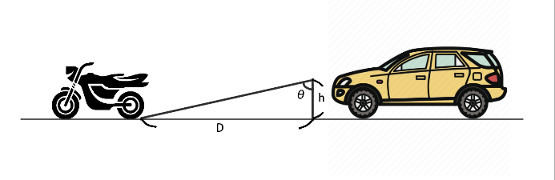

# 系統原理與程式導覽

核心流程位於 [`main.py`](../src/yolov5/main.py)：取得雙攝影機影像、偵測車輛、配對目標、估算距離、計算燈具角度，最後將控制資料傳至 Arduino。

## 影像與偵測

程式開啟 V4L2 攝影機編號 `1`、`2`，將影像翻轉 180 度，使用 letterbox 整理為 640 × 640 輸入，再以 `best_SGD_2612.engine` 推論。非極大值抑制（NMS）的信心門檻為 `0.2`，IoU 門檻為 `0.55`。

模型類別為 `car`、`motorcycle`；`same_object_detect()` 透過 `if class_num != 0: continue` 將測距與控制限制在汽車類別。

## 目標配對

左右畫面的同類別物件必須先符合以下條件：

1. 邊界框左界至少 10 px、右界不超過 630 px，避開畫面邊緣。
2. 左畫面目標中心 x 座標大於右畫面，符合公式所用的正視差方向。
3. 左右目標中心 y 座標差不超過 24 px。
4. 物件裁切影像的 pHash 相似度至少為 `0.7`。

若有多組候選，選擇寬高差分數最小者：

```text
score = 0.5 × (左框寬 − 右框寬)² + 0.5 × (左框高 − 右框高)²
```

程式將此函式命名為 `mmse_lgorithm()`。每個左框各自選擇右框，沒有全域一對一配對限制。

`pHash()` 將影像縮為 32 × 32、轉灰階並執行 DCT，取左上角 8 × 8 係數，依平均值產生 64 位元指紋。`runImageSimilaryFun()` 計算：

```text
similarity = 1 − 不同位元數 / 64
```

## 視差測距

`estimation_distance2()` 使用目標框中心的水平視差：

```text
d = 左框中心 x − 右框中心 x
Z_m = B_cm × 640 / (2 × tan(30°) × d) / 100
```

其中 `B_cm = 30` 為攝影機間距（公分），`Z_m` 為輸出距離（公尺）。公式採畫面寬 640 px、水平視角 60 度的幾何假設；主程式未載入相機校正矩陣或執行影像整流。不同相機與安裝方式需重新確認參數。

## 角度與控制

燈具離地高度設為 `0.86 m`，角度與 UART 指令的關係如下：

```text
angle = degrees(atan(Z_m / 0.86))
command = −round(90 − min(angle_list), 2) + light_angel_bias
```



多個正距離目標中，最小角度對應較近的目標。程式以影格計數決定何時送出角度；連續超過 9 個無目標影格時會傳送字串 `0`。角度偏移預設為 `0`，正負方向及零點需與實際機構一致。

UART 資料為文字數字，未加換行或封包分隔符；接收端需有對應的訊息解析方式。

## 顯示與錄影

主程式顯示左右合併影像、物件標籤、估算距離與處理幀率，輸出至工作目錄的 `output.mp4`。錄影尺寸設為 1280 × 480、20 fps；錄影設定不代表完整處理流程實際達到該幀率。

## 程式入口

| 檔案或函式 | 用途 |
| --- | --- |
| `main.py / run_webcam()` | 影像擷取、推論、顯示、UART 與影片輸出 |
| `main.py / same_object_detect()` | 目標配對、距離與角度計算 |
| `main.py / pHash()`、`cmpHash()` | 影像指紋與相似度 |
| `main.py / estimation_distance2()` | 視差測距 |
| `models/common.py / DetectMultiBackend` | 模型載入與推論後端 |
| `train.py`、`val.py`、`export.py` | 模型訓練、評估與匯出 |
| `detect_old.py` | 單一影像或影片來源的偵測工具，不包含完整燈具控制流程 |

[返回專案首頁](../README.md)
