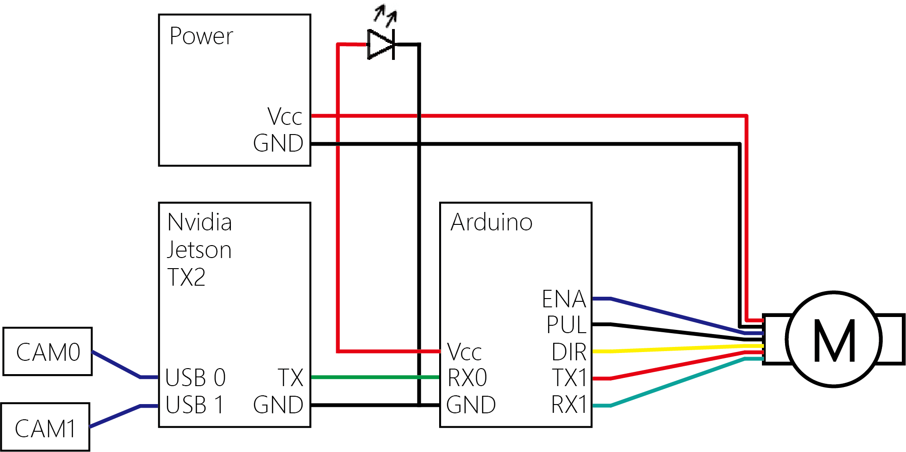

# 硬體與機構

作品以 Jetson TX2 處理影像，透過 Arduino UNO 與步進馬達控制燈具俯仰。完整系統需實體設備與接線。

## 主要元件

| 元件                | 用途                      |
| ----------------- | ----------------------- |
| NVIDIA Jetson TX2 | 雙路影像辨識、配對、測距與控制角度計算     |
| 兩支 USB 紅外攝影機      | 提供左右視角，原設計影像為 640 × 480 |
| Arduino UNO       | 接收 UART 資料並控制馬達         |
| 42 型步進馬達及其驅動電路    | 轉動燈具機構                  |
| 魚眼燈具              | 實體照明與角度調整展示             |
| 電源供應器及配線          | 供應各元件所需電力               |
| 雷切板材、底座、耳軸與軸承     | 固定設備並承載燈具與馬達            |

上圖為原設計架構。隨附 Jetson 主程式已直接計算並傳送角度字串，控制介面請以[程式說明](architecture.md)為準。

## 接線資料

此圖提供原接線設計參考，但目前資料不足以列出完整且可直接照接的針腳表。重建時需確認：

- Jetson 使用的 UART 實體接腳、載板設定、電壓準位及與 Arduino 的共地方式。
- Arduino 接收程式、資料分隔方式、馬達驅動器型號及其控制接腳。
- 馬達與燈具的實際供電、驅動條件、機構行程、方向及零點。
- 攝影機左右順序、間距、固定方式與曝光條件。

## 機構與幾何參數

成品以雷切板材與木製底座固定攝影機、運算平台及電源，利用耳軸、軸承與步進馬達帶動燈具。

`main.py` 的攝影機間距設定為 30 cm，燈具離地高度為 0.86 m。這些值直接參與距離及角度計算，重建機構時需依實際尺寸確認。

[返回專案首頁](../README.md)
