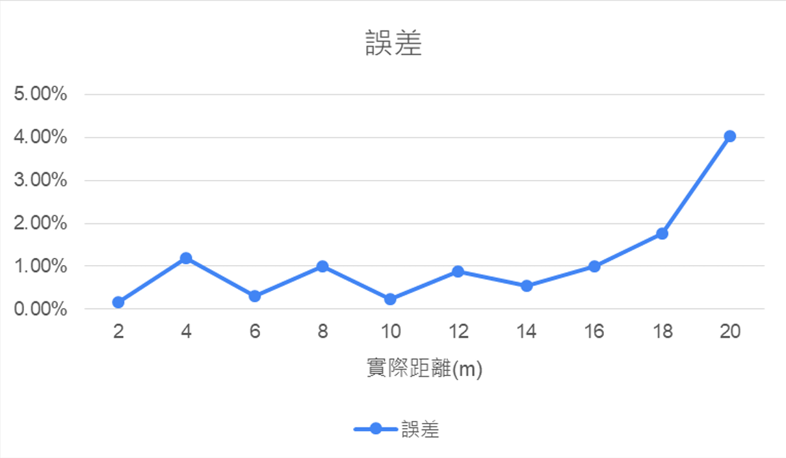
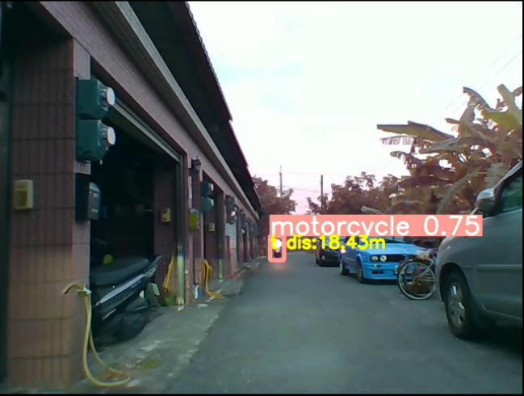
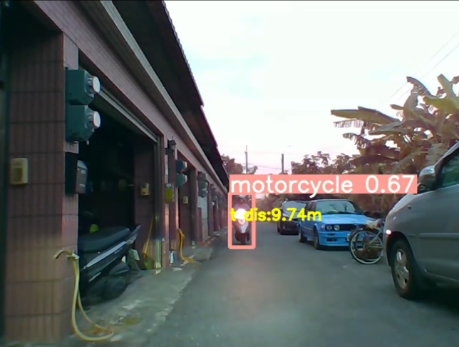
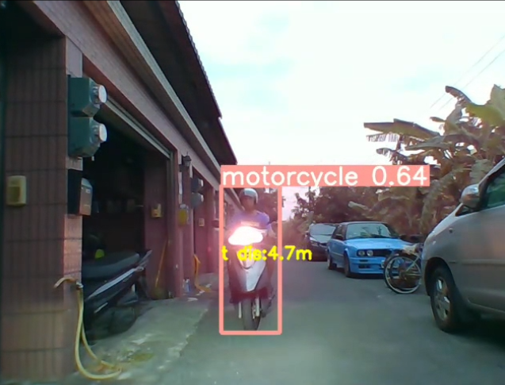

# 實驗結果

## 邊緣推論

YOLOv5n 在 Jetson TX2 上推論一張 640 × 480 影像，使用 TensorRT 後，耗時由約 **60 ms 降為 32 ms**。

## 測距表現

涵蓋 2–20 m 的測試點，遠距離誤差較高，20 m 附近約為 4%。

## 動態目標展示

| 遠距離                             | 中距離                                | 近距離                              |
| ------------------------------- | ---------------------------------- | -------------------------------- |
|  |  |  |
| 估算 18.43 m                      | 估算 9.74 m                          | 估算 4.7 m                         |
[觀看實測影片](https://youtu.be/GQLv9S1hJqA)

## 模型評估

| 指標           | 報告數值    |
| ------------ | ------- |
| Precision    | 0.78578 |
| Recall       | 0.54993 |
| mAP@0.5      | 0.56516 |
| mAP@0.5:0.95 | 0.29096 |

模型類別為汽車與機車，訓練資料結合行車紀錄器畫面與 COCO。報告記錄訓練影像 2,612 筆、驗證影像 432 筆。

[返回專案首頁](../README.md)
